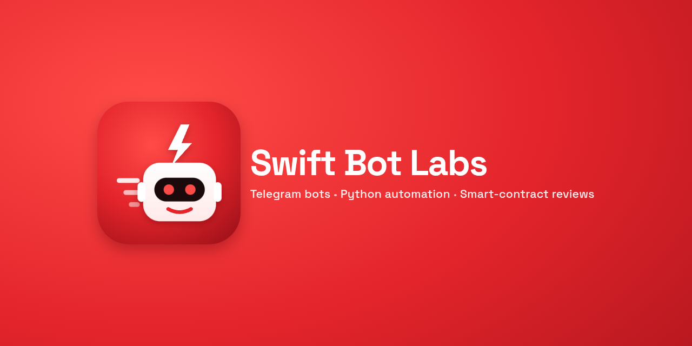

### Swift Bot Labs

Small, reliable tools: **Telegram bots**, **Python automations**, and **smart-contract (Solidity/EVM) security reviews**.
Everything here is real code I use for my own projects.

#### Live

- **[@quickpdfkit_bot](https://t.me/quickpdfkit_bot)**: a file converter inside Telegram. Images → PDF, merge/compress/split PDFs, PDF → JPG, Office → PDF, video/voice → MP3, with a fair per-chat queue and sandboxed converters.

#### Open source

| Project | What it does |
|---|---|
| telegram-file-converter-bot *(coming soon)* | The engine behind @quickpdfkit_bot. |
| [telegram-channel-bots](https://github.com/swiftbotlab/telegram-channel-bots) | Channel mirror (albums, edits and pins stay in sync), CSV-scheduled poster, lead/form collector. |
| [cdp-cli](https://github.com/swiftbotlab/cdp-cli) | A tiny Chrome DevTools Protocol CLI for scripting and testing your own web flows, plus XHR/fetch capture. |
| evm-audit-toolkit *(coming soon)* | Keyless verified-source fetch, Foundry in a no-network sandbox, and a practical review checklist. |

#### Work with me

- **Telegram bots**: forms, menus, paid channel access with Stars, reminders, alerts. Fixed price, working demo before you pay.
- **Python automation**: CSV/Excel cleanup, batch PDF/image jobs, scrapers for your own data, reports.
- **Smart-contract review**: access control, fund flows, oracle and accounting bugs. Written report, PoC for every serious finding.

Paid in **USDC / USDT / ETH / TON** or **Telegram Stars**. Contact: [@quickpdfkit_bot → /hire](https://t.me/quickpdfkit_bot?start=hire)
